# FatturaFacile Enterprise ERP — Community Edition 1.0

[](https://php.net)
[](https://laravel.com)
[](https://postgresql.org)
[]()
[](LICENSE)
[]()

**FatturaFacile Enterprise ERP** is a modern, modular, open-source enterprise resource planning backend engine built on Laravel and PostgreSQL. It delivers end-to-end operational capabilities for high-performance organizations, featuring native multi-tenancy, immutable cryptographic audit logging, a visual workflow approval engine, and deep European compliance (Italian SDI electronic invoicing and Swiss QR-Bill banking).

---

## 🏛️ Platform Overview & Mission

Enterprise software has historically been divided into rigid, monolithic vendor silos or fragile collections of fragmented SaaS micro-tools. FatturaFacile bridges this divide by providing:

1. **Clean Domain-Driven Modular Architecture**: Zero spaghetti code; each business domain is isolated with dedicated Contracts, DTOs, Services, Models, and Events.
2. **True Tenant Data Isolation**: Enforced at the ORM and database connection boundaries via global tenancy scopes and partition-ready schemas.
3. **Audit Immutability & Forensic Integrity**: Append-only audit trails anchored with cryptographic SHA-256 hash chains.
4. **European Fiscal & Cross-Border Compliance**: Out-of-the-box support for Italian SDI (FatturaPA v1.2.2) and Swiss QR-Bill (SIX Payment Standards v2.2 with recursive Modulo 10 SCOR validation).

---

## 📐 Enterprise Architecture

```mermaid
graph TD
    subgraph ClientLayer ["Client & Ingestion Layer"]
        SPA["Web Single Page App"]
        Mobile["Mobile & Field Service App"]
        API["External Integrators / B2B EDI"]
    end

    subgraph ApiGateway ["API Gateway & Tenancy Boundary"]
        Router["HTTP Router /api/v1"]
        TenancyMiddleware["Tenancy Middleware (X-Tenant-ID)"]
        SanctumAuth["Sanctum Bearer Token Auth"]
        RBAC["Granular Role & Permission Matrix"]
    end

    subgraph CorePlatform ["Enterprise Foundation & Core Engine"]
        Workflow["Workflow Engine V2 (Finite State Machine)"]
        EventBus["Transactional Event Bus & Outbox"]
        AuditLedger["Immutable Audit Ledger (SHA-256 Hash Chain)"]
        RefData["Global Multilingual Catalog (IT, EN, DE, FR)"]
    end

    subgraph BusinessDomains ["Enterprise Domain Modules"]
        M02["02 CRM & Pipeline"]
        M05["05 Sales & Invoicing"]
        M13["13 Procurement & AP"]
        M14["14 Inventory & Warehouse"]
        M15["15 Projects & Job Costing"]
        M16["16 Enterprise Asset Management"]
        M17["17 Field Service Management"]
        M18["18 Human Resources & Talent"]
        M19["19 Subscription Billing & ASC 606"]
        M22["22 General Ledger & Accounting"]
        M24["24 Treasury & Cash Banking"]
        M30["30 Manufacturing & MRP"]
    end

    subgraph DataLayer ["Data & Persistence Layer"]
        PG[(PostgreSQL 16+ Primary)]
        Cache[(Redis Cache & Queues)]
    end

    ClientLayer --> Router
    Router --> TenancyMiddleware
    TenancyMiddleware --> SanctumAuth
    SanctumAuth --> RBAC
    RBAC --> CorePlatform
    CorePlatform --> BusinessDomains
    BusinessDomains --> DataLayer
```



---

## 💻 Technology Stack

| Component | Technology | Description |
|---|---|---|
| **Runtime** | PHP 8.2 / 8.3 / 8.5 | High-performance execution, strict types, constructor property promotion |
| **Framework** | Laravel 11.x / 12.x | Enterprise application container, Eloquent ORM, Artisan CLI |
| **Database** | PostgreSQL 16+ / SQLite | Multi-tenant relational storage, JSONB indexing, partitioned audit trails |
| **Authentication** | Laravel Sanctum | State-less API tokens with multi-tenant scopes |
| **Testing Engine** | Pest PHP 3.x / PHPUnit 11 | BDD-style test suites, 100% automated regression coverage |
| **Code Quality** | Laravel Pint | Strict automated PSR-12 and Laravel Boost styling compliance |
| **API Documentation**| OpenAPI 3.1 & Scramble | Dynamic runtime schema generation with interactive Swagger/Redoc UI |
| **Caching & Queues**| Redis 7+ | High-speed cache, rate limiter, asynchronous job dispatching |

---

## ⚡ Quick Start & Installation

### Prerequisites

- **PHP**: `^8.2` (Extensions: `pdo`, `pdo_pgsql`, `pdo_sqlite`, `bcmath`, `mbstring`, `openssl`, `xml`, `curl`)
- **Composer**: `^2.6`
- **PostgreSQL**: `^16.0` (or SQLite `^3.35` for local quick testing)
- **Node.js**: `^20.0` (optional for front-end asset pipelines)

### Docker Compose (One-Liner)

```bash
git clone https://github.com/FatturaFacile/web-api.git fattura-facile
cd fattura-facile
docker compose up -d
docker compose exec app php artisan erp:bootstrap
```

### Local Development Setup

```bash
# 1. Install Composer dependencies
composer install --prefer-dist --optimize-autoloader

# 2. Configure Environment
cp .env.example .env
php artisan key:generate

# 3. Configure Database connection in .env
# DB_CONNECTION=pgsql
# DB_HOST=127.0.0.1
# DB_PORT=5432
# DB_DATABASE=fatturafacile
# DB_USERNAME=postgres
# DB_PASSWORD=your_secure_password

# 4. Bootstrap the Platform with Single Command
php artisan erp:bootstrap
```

### The Platform Bootstrap Command

The `php artisan erp:bootstrap` command brings the entire platform from zero to fully operational in seconds:

```bash
# Full bootstrap with Demo Environment:
php artisan erp:bootstrap

# Production bootstrap (reference and system catalog only, zero demo records):
php artisan erp:bootstrap --without-demo

# Clean bootstrap dropping all tables first:
php artisan erp:bootstrap --fresh
```

#### Bootstrap Execution Phases:
1. **Environment Verification**: Validates PHP runtime version, required extensions, and DB connectivity.
2. **Database Migration**: Executes schema migrations with foreign keys, checks, and GIN indexes.
3. **Global Reference Data Seeding**: Populates 370+ lookup records across 12 domains in 4 languages (`it`, `en`, `de`, `fr`) with `tenant_id = null`.
4. **System Security Provisioning**: Seeds foundational tenants, roles, and granular RBAC permissions.
5. **Dashboard Layout Generation**: Configures role-specific executive and operational dashboard workspaces.
6. **Demo Environment Population**: Creates realistic cross-module operational records for `tenant_demo`.
7. **Cache Optimization**: Warms configuration, routing, and event caches.
8. **Health Check Verification**: Asserts database integrity, tenant existence, and lookup accessibility.

---

## 🛡️ Enterprise Platform Capabilities

### 1. Multi-Tenancy Architecture
- **Tenant Context**: Automatically resolved via the `X-Tenant-ID` HTTP header or authenticated user's current tenant profile.
- **Tenant Isolation**: Model isolation enforced through the `BelongsToTenant` trait and global `TenantScope`. Prevents data leakage across tenant boundaries.

### 2. Workflow Engine V2
- **State Machine**: Supports complex multi-stage approvals (`draft` -> `submitted` -> `cfo_review` -> `approved` -> `completed`).
- **Entity Locking**: Implements `LockableByWorkflowInterface` to protect documents under active review from concurrent modification.
- **Audit Entries**: Captures full decision provenance including approver user ID, transition timestamps, and rejection comments.

### 3. Event Bus & Outbox Pattern
- **Reliable Messaging**: Domain events are committed within the database transaction using an Outbox pattern.
- **Domain Events**: Dispatches business events (`InvoiceIssuedEvent`, `PaymentReceivedEvent`, `LeadConvertedEvent`, `WorkOrderCompletedEvent`).

### 4. Immutable Audit Ledger
- **Tamper Evidence**: Every auditable change stores a SHA-256 cryptographic hash of the payload linked to the `previous_hash` of the prior log entry.
- **GDPR & Compliance**: Captures actor ID, IP address, user agent, old state, new state, and delta diff.

### 5. Multilingual Reference Data
Universal reference data items are stored once with `tenant_id = null` and dynamically translated across 4 locales:
- 🇮🇹 **Italian (`it`)**: Native legal, tax, and accounting terms.
- 🇬🇧 **English (`en`)**: International operational and business standards.
- 🇩🇪 **German (`de`)**: Swiss and DACH compliance terms.
- 🇫🇷 **French (`fr`)**: Swiss Romandie and French enterprise terms.

---

## 📚 API Documentation

### Interactive API Explorer
- **Interactive OpenAPI Specification**: Access the schema at `/docs/api-docs.json` or view the rendered documentation at `/docs/api`.
- **Exporting API Docs**: Run `php artisan docs:export` to generate offline JSON, YAML, and Postman v2.1 collection files.

### Authentication & Headers
All authenticated API requests require a Bearer token and the target tenant UUID:
```http
Authorization: Bearer <your-sanctum-token>
X-Tenant-ID: 01a18933-49e9-700b-9f39-9ad411940151
Content-Type: application/json
Accept: application/json
```

### Core REST Endpoints

| Domain | Method | Endpoint | Description |
|---|---|---|---|
| **Auth** | `POST` | `/api/v1/auth/login` | Authenticate and obtain Sanctum API token |
| **CRM** | `GET` | `/api/v1/crm/leads` | List and search CRM leads |
| **CRM** | `POST` | `/api/v1/crm/opportunities` | Create and advance pipeline opportunities |
| **Sales** | `POST` | `/api/v1/sales/quotes` | Issue sales quotations |
| **Sales** | `POST` | `/api/v1/sales/orders` | Confirm customer sales orders |
| **Invoicing** | `POST` | `/api/v1/invoices` | Generate standard or electronic invoices (SDI/QR) |
| **Procurement**| `POST` | `/api/v1/procurement/purchase-orders` | Issue supplier purchase orders |
| **Inventory** | `GET` | `/api/v1/inventory/items` | Query warehouse stock balances |
| **Assets** | `POST` | `/api/v1/eam/depreciation/run` | Execute monthly fixed asset depreciation |
| **Service** | `POST` | `/api/v1/esm/work-orders` | Dispatch field service work orders |
| **Workflow** | `POST` | `/api/v1/workflows/instances/{id}/transition` | Execute state transition approval |

---

## 👥 Demo Environment & Personas

The demo tenant (`tenant_demo`: *Demo Manufacturing & Services Group S.p.A.*) comes pre-loaded with complete cross-module transactional flows.

| Persona | Role | Email | Password | Primary Workspace |
|---|---|---|---|---|
| **Super Admin** | `admin` | `admin@fatturafacile.local` | `Password123!` | System Configuration & Multi-Tenant Control |
| **CEO** | `ceo` | `ceo@demo-group.com` | `Password123!` | Executive Performance & Revenue KPI Dashboard |
| **CFO** | `cfo` | `cfo@demo-group.com` | `Password123!` | General Ledger, Cash Flow & Financial Reports |
| **Supply Chain Manager** | `supply_chain_manager`| `supplychain@demo-group.com` | `Password123!` | Procurement, Stock Movements & Supplier POs |
| **Operations Manager** | `operations_manager` | `operations@demo-group.com` | `Password123!` | Asset Maintenance, Service Tickets & Work Orders |
| **Lead Auditor** | `auditor` | `auditor@demo-group.com` | `Password123!` | Compliance, Audit Trail & Forensic Hash Logs |

---

## 🧪 Testing Infrastructure

The platform is fortified by a comprehensive Pest PHP feature and integration test suite covering end-to-end business lifecycles:

```bash
# Run all enterprise integration tests:
php artisan test --compact

# Run specific end-to-end scenario lifecycle tests:
php artisan test tests/Feature/ERPFullLifecycleTest.php

# Run cross-module and platform governance tests:
php artisan test tests/Feature/CrossModuleIntegrationTest.php \
                 tests/Feature/EventBusIntegrationTest.php \
                 tests/Feature/OpenAPICoverageTest.php \
                 tests/Feature/AuditCoverageTest.php \
                 tests/Feature/WorkflowCoverageTest.php \
                 tests/Feature/RBACCoverageTest.php
```

### End-to-End Scenarios Covered:
- **Scenario 1 (Procure-to-Pay)**: Purchase Order -> Goods Receipt Line Tracking -> Supplier Bill -> Payment Outflow -> GL Posting.
- **Scenario 2 (Order-to-Cash)**: Lead -> Opportunity -> Quotation -> Sales Order -> Delivery Note -> Electronic Invoice -> Payment -> GL Posting.
- **Scenario 3 (Fixed Asset Lifecycle)**: Category Definition -> Asset Capitalization -> Monthly Depreciation Run -> Preventive Maintenance -> Book Value Updates.
- **Scenario 4 (Project Delivery & Costing)**: Project Initiation -> WBS Tasks -> Billable Timesheet Recording -> Milestone Billing.
- **Scenario 5 (Field Service Execution)**: Incident Ticket -> Work Order Dispatch -> Technician Service Visit -> CSAT 5-Star Feedback.
- **Scenario 6 (Subscription Lifecycle)**: Recurring Subscription -> Automated Billing Run -> Revenue Recognition (ASC 606 / IFRS 15).

---

## 🤝 Contributing & Code of Conduct

We welcome community contributions, bug reports, and pull requests!

1. **Fork the Repository**: Create a feature branch (`git checkout -b feat/amazing-feature`).
2. **Follow Coding Standards**: Keep control structures with braces, explicit return types, and constructor promotion.
3. **Run Code Formatter**: Before submitting, format with Laravel Pint:
   ```bash
   vendor/bin/pint --dirty --format agent
   ```
4. **Ensure Tests Pass**: Run `php artisan test --compact` to guarantee zero regressions.
5. **Open a Pull Request**: Provide a clear summary of your architectural changes.

---

## 📄 License & Enterprise Support

- **Community Edition**: Licensed under the open-source [Apache 2.0 License](LICENSE).
- **Enterprise Support**: For custom SLA guarantees, multi-region high availability deployments, banking connector certifications, and dedicated engineering support, contact `enterprise@fatturafacile.com`.

---

## 🗺️ Roadmap to Release 2.0

- [x] Multi-Tenant Architecture & Database Scopes
- [x] Italian SDI FatturaPA v1.2.2 Invoicing Engine
- [x] Swiss QR-Bill SIX Standards Engine
- [x] General Ledger & Double-Entry Accounting Engine
- [x] Workflow Engine V2 (Finite State Machine)
- [x] Enterprise Asset Management (EAM) & Depreciation Engine
- [x] Enterprise Service Management (ESM) & Field Operations
- [x] Manufacturing MRP II & Shop Floor Control
- [ ] AI-Powered Document OCR & Auto-Categorization (v2.0)
- [ ] Real-Time Banking API Connectors (Open Banking PSD2 / bLink) (v2.0)
- [ ] Multi-Company Consolidation & Transfer Pricing Engine (v2.0)
