# FatturaFacile Enterprise ERP — Community Edition 1.0

[](https://php.net)
[](https://laravel.com)
[](https://postgresql.org)
[]()
[](LICENSE)
[]()

**FatturaFacile Enterprise ERP** is a modern, modular, open-source enterprise resource planning backend engine built on
Laravel and PostgreSQL. It delivers end-to-end operational capabilities for high-performance organizations, featuring
native multi-tenancy, immutable cryptographic audit logging, a visual workflow approval engine, and deep European
compliance (Italian SDI electronic invoicing and Swiss QR-Bill banking).

---

## 🏛️ Platform Overview & Mission

Enterprise software has historically been divided into rigid, monolithic vendor silos or fragile collections of
fragmented SaaS micro-tools. FatturaFacile bridges this divide by providing:

1. **Clean Domain-Driven Modular Architecture**: Zero spaghetti code; each business domain is isolated with dedicated
   Contracts, DTOs, Services, Models, and Events.
2. **True Tenant Data Isolation**: Enforced at the ORM and database connection boundaries via global tenancy scopes and
   partition-ready schemas.
3. **Audit Immutability & Forensic Integrity**: Append-only audit trails anchored with cryptographic SHA-256 hash
   chains.
4. **European Fiscal & Cross-Border Compliance**: Out-of-the-box support for Italian SDI (FatturaPA v1.2.2) and Swiss
   QR-Bill (SIX Payment Standards v2.2 with recursive Modulo 10 SCOR validation).

---

## 📐 Enterprise Architecture

```mermaid
graph TD
    subgraph ClientLayer ["Client & Ingestion Layer"]
        SPA["Web Single Page App"]
        Mobile["Mobile & Field Service App"]
        API["External Integrators / B2B EDI"]
    end

    subgraph ApiGateway ["API Gateway & Tenancy Boundary"]
        Router["HTTP Router /api/v1"]
        TenancyMiddleware["Tenancy Middleware (X-Tenant-Id)"]
        SanctumAuth["Sanctum Bearer Token Auth"]
        RBAC["Granular Role & Permission Matrix"]
    end

    subgraph CorePlatform ["Enterprise Foundation & Core Engine"]
        Workflow["Workflow Engine V2 (Finite State Machine)"]
        EventBus["Transactional Event Bus & Outbox"]
        AuditLedger["Immutable Audit Ledger (SHA-256 Hash Chain)"]
        RefData["Global Multilingual Catalog (IT, EN, DE, FR)"]
    end

    subgraph BusinessDomains ["Enterprise Domain Modules"]
        M02["02 CRM & Pipeline"]
        M05["05 Sales & Invoicing"]
        M13["13 Procurement & AP"]
        M14["14 Inventory & Warehouse"]
        M15["15 Projects & Job Costing"]
        M16["16 Enterprise Asset Management"]
        M17["17 Field Service Management"]
        M18["18 Human Resources & Talent"]
        M19["19 Subscription Billing & ASC 606"]
        M22["22 General Ledger & Accounting"]
        M24["24 Treasury & Cash Banking"]
        M30["30 Manufacturing & MRP"]
    end

    subgraph DataLayer ["Data & Persistence Layer"]
        PG[(PostgreSQL 16+ Primary)]
        Cache[(Redis Cache & Queues)]
    end

    ClientLayer --> Router
    Router --> TenancyMiddleware
    TenancyMiddleware --> SanctumAuth
    SanctumAuth --> RBAC
    RBAC --> CorePlatform
    CorePlatform --> BusinessDomains
    BusinessDomains --> DataLayer
```



---

## 💻 Technology Stack

| Component             | Technology                | Description                                                               |
|-----------------------|---------------------------|---------------------------------------------------------------------------|
| **Runtime**           | PHP 8.2 / 8.3 / 8.5       | High-performance execution, strict types, constructor property promotion  |
| **Framework**         | Laravel 11.x / 12.x       | Enterprise application container, Eloquent ORM, Artisan CLI               |
| **Database**          | PostgreSQL 16+ / SQLite   | Multi-tenant relational storage, JSONB indexing, partitioned audit trails |
| **Authentication**    | Laravel Sanctum           | State-less API tokens with multi-tenant scopes                            |
| **Testing Engine**    | Pest PHP 3.x / PHPUnit 11 | BDD-style test suites, 100% automated regression coverage                 |
| **Code Quality**      | Laravel Pint              | Strict automated PSR-12 and Laravel Boost styling compliance              |
| **API Documentation** | OpenAPI 3.1 & Scramble    | Dynamic runtime schema generation with interactive Swagger/Redoc UI       |
| **Caching & Queues**  | Redis 7+                  | High-speed cache, rate limiter, asynchronous job dispatching              |

---

## ⚡ Quick Start & Installation

### Prerequisites

- **To try it**: only Docker with the Compose plugin (see "Try it now")
- **To develop**: PHP `^8.5` (Extensions: `pdo`, `pdo_pgsql`, `bcmath`, `mbstring`, `openssl`, `xml`, `curl`)
  and Composer `^2.6`, or Docker alone with Laravel Sail
- **Docker**: for PostgreSQL and Mailpit
- **Node.js**: `^22.0` with Corepack, for [web-frontend](https://github.com/FatturaFacile/web-frontend)

### Try it now (Docker, no PHP or Composer needed)

Runs the published image [`docker.io/fatturafacile/api:0.1.2`](https://hub.docker.com/r/fatturafacile/api) with
PostgreSQL 16 and a minimal nginx. Nothing is built and the `vendor/` folder is not needed. Only Docker with the Compose
plugin is required. Everything listens on `127.0.0.1`. This is for a quick trial, not for production.

```bash
git clone https://github.com/FatturaFacile/web-api.git && cd web-api
cp deploy/local/env.example deploy/local/.env
docker compose -f deploy/local/compose.yaml up -d --wait
docker compose -f deploy/local/compose.yaml exec app php artisan migrate --force
docker compose -f deploy/local/compose.yaml exec app php artisan erp:bootstrap
```

Check it: `curl http://localhost:8000/up` answers 200, the Swagger UI is on http://localhost:8000/api/documentation and
the OpenAPI file on http://localhost:8000/docs/api-docs.json. Demo login (via `POST /api/v1/auth/login`):
`admin@demo-group.com` / `Password123!`.

- The tag is pinned in `deploy/local/compose.yaml`; change it there to try another release (tags on Docker Hub).
- `APP_KEY` is generated at the first start and kept in the storage volume. Credentials and the port (`API_PORT`) are in
  `deploy/local/.env`, which is not committed.
- The image has no PHP Redis extension, so this stack has no Redis: cache, sessions and queue use the database and
  emails go to the log.
- Port 8000 busy (for example by `php artisan serve`)? Set `API_PORT` in `deploy/local/.env` before `up`.
- The stack is called `fatturafacile-demo` whatever the folder: a second clone run with the same command reuses the same
  containers and database. To keep two apart, add `-p <name>` to every `docker compose` command.
- Verified from a clean state (fresh volumes): `up --wait` takes a few seconds, then `/up`, the Swagger UI, `api-docs.json`
  and the demo login all answer.
- Stop and keep the data: `docker compose -f deploy/local/compose.yaml stop`. Remove everything, data included:
  `docker compose -f deploy/local/compose.yaml down -v`.

> `docker compose up` without `-f` starts `compose.yaml` (the Laravel Sail development stack), and
> `docker-compose.yml` is the production stack (nginx on 80/443, certbot, a mandatory `.env` that must define `DB_PASSWORD`
> and `REDIS_PASSWORD`: without them it refuses to start): neither is for a first trial.

### Develop (you change the code)

`vendor/` is not in the repository: run `composer install` first (PHP `^8.5`; without PHP locally you can run
`docker run --rm -u "$(id -u):$(id -g)" -v "$PWD":/app -w /app composer:2 install --ignore-platform-reqs`).
Then choose one of the two ways.

#### With Laravel Sail (everything in Docker)

`compose.yaml` runs PHP 8.5, PostgreSQL 16, Redis and Mailpit (the schema is PostgreSQL-only: MySQL does not work).

```bash
composer install
cp .env.example .env
```

```dotenv
# Set these values in .env
DB_CONNECTION=pgsql
DB_HOST=pgsql
DB_PORT=5432
DB_DATABASE=fatturafacile
DB_USERNAME=sail
DB_PASSWORD=password
REDIS_HOST=redis
```

```bash
export WWWUSER=$(id -u) WWWGROUP=$(id -g)   # if port 80 is busy: also APP_PORT=8081
./vendor/bin/sail up -d laravel.test pgsql redis mailpit
./vendor/bin/sail artisan key:generate
./vendor/bin/sail artisan migrate
./vendor/bin/sail artisan erp:bootstrap
./vendor/bin/sail artisan l5-swagger:generate   # regenerate the OpenAPI file
```

The API answers on `http://localhost` (or `APP_PORT`): `/up`, `/api/documentation`. Stop with `./vendor/bin/sail down`
(`-v` also removes the database).

#### With PHP on your machine

##### First run

```bash
# 1. Install the dependencies and create the environment file
composer install
cp .env.example .env
```

```dotenv
# 2. Set these values in .env
DB_CONNECTION=pgsql
DB_HOST=127.0.0.1
DB_PORT=5432
DB_DATABASE=fatturafacile
DB_USERNAME=postgres
DB_PASSWORD=postgres

QUEUE_CONNECTION=database
# QUEUE_CONNECTION=sync # For immediate testing

MAIL_MAILER=smtp
MAIL_HOST=127.0.0.1
MAIL_PORT=1025
```

```bash
# 3. Start PostgreSQL and Mailpit
docker compose -f docker-compose.local.yml up -d --wait

# 4. Prepare the application and the database
php artisan key:generate
php artisan migrate
php artisan erp:bootstrap
```

#### Every day

```bash
docker compose -f docker-compose.local.yml up -d --wait

php artisan serve        # terminal 1: API on http://localhost:8000
php artisan queue:work   # terminal 2: without it, queued emails are not sent
```

Then start the frontend in `web-frontend` with `corepack pnpm install` (first time only) and
`corepack pnpm run start:local`.

| Service | Address |
|---|---|
| Application | https://localhost:4200 (`admin@demo-group.com` / `Password123!`) |
| API | http://localhost:8000 |
| Mailpit inbox | http://localhost:8025 |

#### Managing the local services

```bash
docker compose -f docker-compose.local.yml stop      # stop them, keeping the data
docker compose -f docker-compose.local.yml down      # remove the containers, keeping the data
docker compose -f docker-compose.local.yml down -v   # remove the containers and the database

php artisan migrate:fresh && php artisan erp:bootstrap   # rebuild the database from scratch
```

#### Approving a registration

A new account needs a confirmed email address and the approval of a platform administrator, through the API:

```bash
php artisan auth:grant-platform-admin admin@demo-group.com
```

Sign in as that user, list the requests with `GET /api/v1/admin/tenant-access-requests`, then call
`POST /api/v1/admin/tenant-access-requests/{id}/approve`, `/move` or `/reject`.

#### Recovering a password

`POST /api/v1/auth/forgot-password` always answers 202, and sends a link only to active accounts with a confirmed
address. The link opens `/reset-password` on the frontend and lasts `AUTH_PASSWORD_RESET_EXPIRES_MINUTES`. Completing the
reset revokes the user's access tokens and deletes their rows in `sessions`, which requires `SESSION_DRIVER=database`.

### The Platform Bootstrap Command

The `php artisan erp:bootstrap` command fills a migrated database with reference data, users and demo records. It does
not create the tables: run `php artisan migrate` first.

```bash
# Full bootstrap with Demo Environment:
php artisan erp:bootstrap

# Production bootstrap (reference and system catalog only, zero demo records):
php artisan erp:bootstrap --without-demo
```

#### Bootstrap Execution Phases:

1. **Roles & Permissions**: Seeds the global roles and system permissions.
2. **Workflow Engine**: Seeds the approval statuses and states.
3. **Global Reference Data**: Populates the lookups and translations in 4 languages (`it`, `en`, `de`, `fr`).
4. **Domain Catalogs**: Registers the reference catalogs of each module.
5. **Tenants**: Provisions the base and demo tenants.
6. **Users**: Creates the administrative and departmental users.
7. **Dashboards**: Generates the role-specific dashboard layouts.
8. **Demo Environment**: Creates the cross-module demo records (skipped with `--without-demo`).

---

## 🛡️ Enterprise Platform Capabilities

### 1. Multi-Tenancy Architecture

- **Tenant Context**: Automatically resolved via the `X-Tenant-Id` HTTP header or authenticated user's current tenant
  profile.
- **Tenant Isolation**: Model isolation enforced through the `BelongsToTenant` trait and global `TenantScope`. Prevents
  data leakage across tenant boundaries.

### 2. Workflow Engine V2

- **State Machine**: Supports complex multi-stage approvals (`draft` -> `submitted` -> `cfo_review` -> `approved` ->
  `completed`).
- **Entity Locking**: Implements `LockableByWorkflowInterface` to protect documents under active review from concurrent
  modification.
- **Audit Entries**: Captures full decision provenance including approver user ID, transition timestamps, and rejection
  comments.

### 3. Event Bus & Outbox Pattern

- **Reliable Messaging**: Domain events are committed within the database transaction using an Outbox pattern.
- **Domain Events**: Dispatches business events (`InvoiceIssuedEvent`, `PaymentReceivedEvent`, `LeadConvertedEvent`,
  `WorkOrderCompletedEvent`).

### 4. Immutable Audit Ledger

- **Tamper Evidence**: Every auditable change stores a SHA-256 cryptographic hash of the payload linked to the
  `previous_hash` of the prior log entry.
- **GDPR & Compliance**: Captures actor ID, IP address, user agent, old state, new state, and delta diff.

### 5. Multilingual Reference Data

Universal reference data items are stored once with `tenant_id = null` and dynamically translated across 4 locales:

- 🇮🇹 **Italian (`it`)**: Native legal, tax, and accounting terms.
- 🇬🇧 **English (`en`)**: International operational and business standards.
- 🇩🇪 **German (`de`)**: Swiss and DACH compliance terms.
- 🇫🇷 **French (`fr`)**: Swiss Romandie and French enterprise terms.

---

## 📚 API Documentation

### Interactive API Explorer

- **Interactive OpenAPI Specification**: Access the schema at `/docs/api-docs.json` or view the rendered documentation
  at `/docs/api`.
- **Exporting API Docs**: Run `php artisan docs:export` to generate offline JSON, YAML, and Postman v2.1 collection
  files.

### Authentication & Headers

All authenticated API requests require a Bearer token and the target tenant UUID:

```http
Authorization: Bearer <your-sanctum-token>
X-Tenant-Id: 01a18933-49e9-700b-9f39-9ad411940151
Content-Type: application/json
Accept: application/json
```

### Core REST Endpoints

| Domain          | Method | Endpoint                                      | Description                                       |
|-----------------|--------|-----------------------------------------------|---------------------------------------------------|
| **Auth**        | `POST` | `/api/v1/auth/login`                          | Authenticate and obtain Sanctum API token         |
| **CRM**         | `GET`  | `/api/v1/crm/leads`                           | List and search CRM leads                         |
| **CRM**         | `POST` | `/api/v1/crm/opportunities`                   | Create and advance pipeline opportunities         |
| **Sales**       | `POST` | `/api/v1/sales/quotes`                        | Issue sales quotations                            |
| **Sales**       | `POST` | `/api/v1/sales/orders`                        | Confirm customer sales orders                     |
| **Invoicing**   | `POST` | `/api/v1/invoices`                            | Generate standard or electronic invoices (SDI/QR) |
| **Procurement** | `POST` | `/api/v1/procurement/purchase-orders`         | Issue supplier purchase orders                    |
| **Inventory**   | `GET`  | `/api/v1/inventory/items`                     | Query warehouse stock balances                    |
| **Assets**      | `POST` | `/api/v1/eam/depreciation/run`                | Execute monthly fixed asset depreciation          |
| **Service**     | `POST` | `/api/v1/esm/work-orders`                     | Dispatch field service work orders                |
| **Workflow**    | `POST` | `/api/v1/workflows/instances/{id}/transition` | Execute state transition approval                 |

---

## 👥 Demo Environment & Personas

The demo tenant (`tenant_demo`: *Demo Manufacturing & Services Group S.p.A.*) comes pre-loaded with complete
cross-module transactional flows.

| Persona                  | Role                   | Email                        | Password       | Primary Workspace                                |
|--------------------------|------------------------|------------------------------|----------------|--------------------------------------------------|
| **Super Admin**          | `admin`                | `admin@fatturafacile.local`  | `Password123!` | System Configuration & Multi-Tenant Control      |
| **CEO**                  | `ceo`                  | `ceo@demo-group.com`         | `Password123!` | Executive Performance & Revenue KPI Dashboard    |
| **CFO**                  | `cfo`                  | `cfo@demo-group.com`         | `Password123!` | General Ledger, Cash Flow & Financial Reports    |
| **Supply Chain Manager** | `supply_chain_manager` | `supplychain@demo-group.com` | `Password123!` | Procurement, Stock Movements & Supplier POs      |
| **Operations Manager**   | `operations_manager`   | `operations@demo-group.com`  | `Password123!` | Asset Maintenance, Service Tickets & Work Orders |
| **Lead Auditor**         | `auditor`              | `auditor@demo-group.com`     | `Password123!` | Compliance, Audit Trail & Forensic Hash Logs     |

---

## 🧪 Testing Infrastructure

The platform is fortified by a comprehensive Pest PHP feature and integration test suite covering end-to-end business
lifecycles:

The tests use a dedicated PostgreSQL kept in memory, from `docker-compose.test.yml` and `.env.testing`. It takes port
5432 like the local database, so run one at a time:

```bash
docker compose -f docker-compose.local.yml stop           # free port 5432, keeping the local data
docker compose -f docker-compose.test.yml up -d --wait    # start the test database
php artisan migrate:fresh --env=testing --force           # create its tables

# ... run the tests below ...

docker compose -f docker-compose.test.yml down            # remove the test database
docker compose -f docker-compose.local.yml up -d --wait   # back to local development
```

```bash
# Run all enterprise integration tests:
php artisan test --compact

# Run specific end-to-end scenario lifecycle tests:
php artisan test tests/Feature/ERPFullLifecycleTest.php

# Run cross-module and platform governance tests:
php artisan test tests/Feature/CrossModuleIntegrationTest.php \
                 tests/Feature/EventBusIntegrationTest.php \
                 tests/Feature/OpenAPICoverageTest.php \
                 tests/Feature/AuditCoverageTest.php \
                 tests/Feature/WorkflowCoverageTest.php \
                 tests/Feature/RBACCoverageTest.php
```

### End-to-End Scenarios Covered:

- **Scenario 1 (Procure-to-Pay)**: Purchase Order -> Goods Receipt Line Tracking -> Supplier Bill -> Payment Outflow ->
  GL Posting.
- **Scenario 2 (Order-to-Cash)**: Lead -> Opportunity -> Quotation -> Sales Order -> Delivery Note -> Electronic
  Invoice -> Payment -> GL Posting.
- **Scenario 3 (Fixed Asset Lifecycle)**: Category Definition -> Asset Capitalization -> Monthly Depreciation Run ->
  Preventive Maintenance -> Book Value Updates.
- **Scenario 4 (Project Delivery & Costing)**: Project Initiation -> WBS Tasks -> Billable Timesheet Recording ->
  Milestone Billing.
- **Scenario 5 (Field Service Execution)**: Incident Ticket -> Work Order Dispatch -> Technician Service Visit -> CSAT
  5-Star Feedback.
- **Scenario 6 (Subscription Lifecycle)**: Recurring Subscription -> Automated Billing Run -> Revenue Recognition (ASC
  606 / IFRS 15).

---

## 🤝 Contributing & Code of Conduct

We welcome community contributions, bug reports, and pull requests!

1. **Fork the Repository**: Create a feature branch (`git checkout -b feat/amazing-feature`).
2. **Follow Coding Standards**: Keep control structures with braces, explicit return types, and constructor promotion.
3. **Run Code Formatter**: Before submitting, format with Laravel Pint:
   ```bash
   vendor/bin/pint --dirty --format agent
   ```
4. **Ensure Tests Pass**: Run `php artisan test --compact` to guarantee zero regressions.
5. **Open a Pull Request**: Provide a clear summary of your architectural changes.

---

## 📄 License & Enterprise Support

- **Community Edition**: Licensed under the open-source [Apache 2.0 License](LICENSE).
- **Enterprise Support**: For custom SLA guarantees, multi-region high availability deployments, banking connector
  certifications, and dedicated engineering support, contact `enterprise@fatturafacile.com`.

---

## 🗺️ Roadmap to Release 2.0

- [x] Multi-Tenant Architecture & Database Scopes
- [x] Italian SDI FatturaPA v1.2.2 Invoicing Engine
- [x] Swiss QR-Bill SIX Standards Engine
- [x] General Ledger & Double-Entry Accounting Engine
- [x] Workflow Engine V2 (Finite State Machine)
- [x] Enterprise Asset Management (EAM) & Depreciation Engine
- [x] Enterprise Service Management (ESM) & Field Operations
- [x] Manufacturing MRP II & Shop Floor Control
- [ ] AI-Powered Document OCR & Auto-Categorization (v2.0)
- [ ] Real-Time Banking API Connectors (Open Banking PSD2 / bLink) (v2.0)
- [ ] Multi-Company Consolidation & Transfer Pricing Engine (v2.0)
