# FatturaFacile Enterprise ERP — Community Edition 1.0

[](https://php.net)
[](https://laravel.com)
[](https://postgresql.org)
[]()
[](https://github.com/FatturaFacile/web-api/actions/workflows/erp-ci.yml)
[](LICENSE)
[]()

**FatturaFacile Enterprise ERP** is a modern, modular, open-source enterprise resource planning backend engine built on **Laravel 13** and **PHP 8.6**. It delivers robust, multi-tenant business operations for growing organizations, featuring native multi-tenancy, immutable cryptographic audit logging, a visual workflow approval state machine, and deep European fiscal compliance (Italian SDI electronic invoicing and Swiss QR-Bill banking).

---

## 1. Overview

FatturaFacile provides an enterprise-grade RESTful API (`/api/v1`) designed for web single-page applications, mobile clients, and B2B system integrators.

### Core Capabilities

- **Fiscal & Cross-Border Compliance**:
  - **Italy (IT)**: Native Agenzia delle Entrate XML schema `FatturaElettronica` v1.2.2 for SDI transmission, recipient code/PEC routing, ordinary/forfettario regimes, split payment, and reverse charge.
  - **Switzerland (CH)**: SIX Group Swiss QR-Bill v2.2 compliance with recursive Modulo 10 SCOR reference calculation, 0.05 CHF rounding convention, and ISO 20022 banking formats (`pain.001`, `camt.053`/`camt.054`).
- **Commercial Operations**: End-to-end Order-to-Cash (Leads, Opportunities, Quotes, Sales Orders, Deliveries, Invoices) and Procure-to-Pay (Purchase Orders, Goods Receipts, Supplier Bills, 3-Way Matching).
- **Supply Chain & Logistics**: Multi-warehouse stock management, lot/serial tracking, stock movements, variant generation, and barcode/label printing.
- **Financial & Accounting**: Double-entry general ledger, automated bank reconciliation rules, VAT settlements, vendor aging, payment schedules, and deferred revenue recognition.
- **Operations & Field Service**: Work orders, service intervention reports (*rapportini*), technician scheduling, digital signatures, and asset management (EAM) with depreciation runs.
- **Enterprise Governance**: GDPR / Swiss nLPD compliance tooling, data subject requests (DSR), tamper-evident audit logging, and configurable role-based access control.

---

## 2. Architecture & Design

The application follows **Clean Architecture** and **Domain-Driven Design (DDD)** principles to separate business invariants from framework infrastructure.

```mermaid
graph TD
    subgraph ClientLayer ["Client & Ingestion Layer"]
        SPA["Web Single Page App"]
        Mobile["Field Service & Mobile Clients"]
        Integrators["B2B EDI & External Integrators"]
    end

    subgraph ApiGateway ["API Gateway & Tenancy Boundary"]
        Router["HTTP Router /api/v1"]
        TenancyMiddleware["IdentifyTenant Middleware (X-Tenant-Id)"]
        SanctumAuth["Sanctum Token Auth & 2FA"]
        RBAC["Spatie Role & Permission Matrix"]
    end

    subgraph CorePlatform ["Enterprise Foundation Packages"]
        Workflow["Workflow Engine (Finite State Machine)"]
        EventBus["Transactional Event Bus & Outbox Pattern"]
        AuditLedger["Immutable Audit Ledger (SHA-256 Chains)"]
        RefData["Multilingual Reference Catalogs (IT, EN, DE, FR)"]
    end

    subgraph BusinessDomains ["Domain Modules (Bounded Contexts)"]
        M02["02 CRM & Pipeline"]
        M05["05 Invoicing & Sales"]
        M06["06 SDI Electronic Invoicing"]
        M13["13 Procurement & AP"]
        M14["14 Inventory & Warehouse"]
        M16["16 Asset Management"]
        M17["17 Service Management"]
        M18["18 Human Resources & Payroll"]
        M19["19 Subscription Billing"]
        M21["21 Workflow Engine"]
        M22["22 General Ledger"]
        M24["24 Treasury & Banking"]
        M30["30 Manufacturing & MRP"]
    end

    subgraph DataLayer ["Data & Persistence Layer"]
        PG["PostgreSQL 16+ / SQLite Database"]
        CacheQueue["Redis Cache, Locks & Queues"]
    end

    ClientLayer --> Router
    Router --> TenancyMiddleware
    TenancyMiddleware --> SanctumAuth
    SanctumAuth --> RBAC
    RBAC --> CorePlatform
    CorePlatform --> BusinessDomains
    BusinessDomains --> DataLayer
```



### Key Architectural Patterns

- **Clean Architecture & Layering**:
  - **Presentation (`app/Http`)**: Controllers act as thin orchestrators. Form Requests define strict mutation contracts and validation rules. Responses are standardized via `JsonResource` and RFC 7807 Problem Details.
  - **Application (`app/Services`, `app/Actions`, `app/DTOs`)**: Encapsulates workflow execution, calculation services, and data transfer objects across module boundaries.
  - **Domain (`modules/*/src/Domain`, `app/Models`, `app/Events`)**: Enforces fiscal rules, state transitions, entity guards, and domain events.
  - **Infrastructure (`app/Support`, `packages/*`)**: Database dialect abstractions (`SqlDialect`), storage management, XML/SEPA serializers, and external gateways.
- **Modular Bounded Contexts (`modules/`)**: Over 60 specialized business domains located in `modules/` (e.g., `02_CRM`, `05_Invoicing`, `06_SDI`, `13_Procurement`, `14_Inventory`, `22_GeneralLedger`, `24_Treasury`), mapped under the `Modules\` namespace.
- **Shared Enterprise Packages (`packages/`)**: Reusable platform building blocks under `Enterprise\` (`ai-gateway`, `audit-ledger`, `enterprise-foundation`, `event-bus`, `feature-flags`, `multi-tenant`, `openapi`).
- **Multi-Tenancy**:
  - Request-scoped tenant context resolved via `IdentifyTenant` middleware through the `X-Tenant-Id` header (or authenticated user tenant binding).
  - Models implement `BelongsToTenant` and apply global `TenantScope`. Operational queries automatically filter by `tenant_id`.
  - Global reference data records (`tenant_id IS NULL`) are shared across all tenants in read-only mode.
- **Authentication & Security**:
  - Token-based API authentication via **Laravel Sanctum** with support for stateful SPA cookies.
  - Multi-Factor Authentication (TOTP 2FA) with recovery codes.
  - Enterprise SSO (OpenID Connect / SAML via `onelogin/php-saml`) and SCIM 2.0 provisioning.
  - Granular RBAC powered by `spatie/laravel-permission`.
  - Security hardening: Mandatory HTTPS (`EnforceHttps`), strict security headers, and rate-limiting tiers.
- **Audit Ledger & Immutability**:
  - Append-only forensic audit trail where every auditable modification is cryptographically hashed with SHA-256 and chained to the previous entry's hash (`previous_hash`).
- **Event Bus & Outbox Pattern**:
  - Reliable event dispatching using the Outbox pattern (`RelayOutboxEventsJob`) inside database transactions to ensure consistency.
- **Localization Strategy**:
  - First-class support for 4 business locales: Italian (`it`), English (`en`), German (`de`), and French (`fr`).
  - Request locale negotiated via `SetLocale` middleware (`Accept-Language` header or user preference).
  - System translations reside in `lang/` and database lookup tables seeded with localized reference terms.

---

## 3. Tech Stack & Prerequisites

### System Requirements

- **PHP**: `^8.6` (Strict typing `declare(strict_types=1)`, Constructor Property Promotion).
  - **Required Extensions**: `dom`, `pdo`, `pdo_pgsql`, `pdo_mysql`, `mbstring`, `zip`, `exif`, `pcntl`, `bcmath`, `gd`, `intl`, `openssl`, `xmlwriter`, `curl`, and `redis` (`phpredis`).
- **Composer**: `^2.6`
- **Node.js**: `^22.0` (with Corepack) for frontend asset building with Vite.
- **Docker & Docker Compose**: (Optional, recommended for PostgreSQL, Redis, and Mailpit).

### Technology Matrix

| Layer | Component | Version / Specification |
|---|---|---|
| **Framework** | Laravel | `^13.17` (Laravel 13) |
| **Databases** | SQLite | Default for Local Development & Automated Tests (`DB_FOREIGN_KEYS=true`) |
| | PostgreSQL | `16+` (Strictly Production & CI Pipelines) |
| | MySQL / MariaDB | Dialect supported via `SqlDialect` abstraction |
| **Authentication** | Laravel Sanctum | `^4.0` |
| **Permissions** | Spatie Laravel Permission | `^8.3` |
| **Caching & Locks** | Redis / Database | Redis 7+ via `phpredis` or Database store |
| **Queues** | Redis / Database / Sync | Configurable via `QUEUE_CONNECTION` |
| **Mailers** | SMTP / Log / Postmark / Resend | Mailpit (`127.0.0.1:1025`) for local dev |
| **API Documentation** | L5-Swagger & Scramble | OpenAPI 3.1 (`darkaonline/l5-swagger`, `dedoc/scramble`) |
| **Code Quality** | Laravel Pint & Larastan | Pint `^1.27`, PHPStan / Larastan `^3.14` (Level 5) |
| **Testing** | Pest PHP & PHPUnit | Pest `^5.3`, PHPUnit `^13.4` |

---

## 4. Project Structure

```text
├── app/                        # Core application layer
│   ├── Actions/                # Reusable single-action domain operations
│   ├── Console/Commands/       # Artisan commands (erp:bootstrap, docs:export, etc.)
│   ├── DTOs/                   # Data Transfer Objects
│   ├── Enums/                  # Native PHP typed enums
│   ├── Events/ & Listeners/    # Application events and event handlers
│   ├── Http/                   # Controllers, FormRequests, Middleware, Resources
│   ├── Jobs/                   # Asynchronous background jobs
│   ├── Models/                 # Eloquent entities & BelongsToTenant traits
│   ├── Policies/               # Spatie and domain authorization policies
│   ├── Rules/                  # Custom validation rules (Codice Fiscale, P.IVA, etc.)
│   ├── Services/               # Core business services (SDI, QR-Bill, Tenancy, Auth)
│   └── Support/                # Database dialect helpers and utilities
├── modules/                    # Bounded context modules (PSR-4 Modules\)
│   ├── 02_CRM/                 # Contacts, leads, opportunities, pipeline
│   ├── 05_Invoicing/           # Sales quotes, orders, invoices, payment terms
│   ├── 06_SDI/                 # Italian electronic invoice generation & transmission
│   ├── 13_Procurement/         # Purchase orders, supplier bills, goods receipts
│   ├── 14_Inventory/           # Stock management, warehouses, variants, lots
│   ├── 16_AssetManagement/     # Fixed assets, capitalization, depreciation
│   ├── 17_ServiceManagement/   # Tickets, work orders, service reports
│   ├── 18_HumanResources/      # Employee master data, leave tracking, cross-border HR
│   ├── 19_SubscriptionBilling/ # Recurring contracts, metered usage, ASC 606 revenue
│   ├── 21_Workflow/            # State machine approval engine & transitions
│   ├── 22_GeneralLedger/       # Double-entry accounting, journals, charts of accounts
│   ├── 24_Treasury/            # Bank accounts, CAMT/CBI imports, reconciliation
│   └── ...                     # About 100 module folders in total (industry and operational modules)
├── packages/                   # Enterprise platform infrastructure packages
│   ├── ai-gateway/             # Unified AI integration client
│   ├── audit-ledger/           # Cryptographic immutable audit trail
│   ├── enterprise-foundation/  # Shared contracts, value objects, exceptions
│   ├── event-bus/              # Outbox pattern and transactional event dispatching
│   ├── feature-flags/          # Feature toggle engine
│   ├── multi-tenant/           # Tenant context, scoping, and middleware
│   └── openapi/                # OpenAPI schema decorators and specs
├── services/mes/               # .NET manufacturing execution (MES) service, with its own README
├── deploy/                     # Compose files and configuration for dev, local and monitoring
├── docs/                       # API documentation (docs/api/openapi.json), architecture notes, deployment checklist
├── scripts/                    # Developer and maintenance scripts
├── routes/                     # HTTP and console route definitions
│   ├── api.php                 # Primary /api/v1 RESTful API endpoints
│   ├── console.php             # Scheduled task definitions and artisan cron
│   ├── enterprise_auth.php     # SSO, OIDC, and SCIM 2.0 routes
│   ├── privacy_operations.php  # GDPR / Swiss nLPD compliance endpoints
│   └── web.php                 # Health probes (/up) and documentation routes
├── database/                   # Database migrations, seeders, and factories
│   ├── factories/              # Model factories for testing
│   ├── migrations/             # 480+ relational database schema migrations
│   └── seeders/                # System catalogs, translations, and demo seeders
├── config/                     # Application configuration files
├── lang/                       # Localization dictionaries (de, en, fr, it)
└── tests/                      # Feature, Unit, and Architecture test suites
```

---

## 5. Local Setup & Installation

You can set up the backend using local PHP or Docker.

### Local Development with SQLite (Default & Mandatory)

1. **Clone the repository and install dependencies**:
   ```bash
   git clone https://github.com/FatturaFacile/web-api.git
   cd web-api
   composer install
   ```

2. **Configure environment**:
   ```bash
   cp .env.example .env
   php artisan key:generate
   ```
   *(SQLite is the default connection in `.env.example`: `DB_CONNECTION=sqlite`, `DB_FOREIGN_KEYS=true`).*

3. **Initialize SQLite database**:
   ```bash
   touch database/database.sqlite
   ```

4. **Run database migrations and seed system catalogs**:
   ```bash
   php artisan migrate:fresh --seed
   ```
   *Tip: Use `php artisan erp:bootstrap --without-demo` if you want a clean installation without sample transactional records.*

---

### Local Supporting Services (Mailpit)

For local email testing without external credentials:
```bash
docker compose -f docker-compose.local.yml up -d mailpit
```

---

### Option C: Laravel Sail (Full Docker Stack)

If you prefer to run PHP inside Docker without installing it locally:

```bash
composer install # or via Docker composer image
cp .env.example .env
./vendor/bin/sail up -d laravel.test pgsql redis mailpit
./vendor/bin/sail artisan key:generate
./vendor/bin/sail artisan migrate
./vendor/bin/sail artisan erp:bootstrap
```

---

## 6. Running the Application

### 1. HTTP Server

Run the local development server:

```bash
php artisan serve
```

Or run via Composer script (with automatic worker management):

```bash
composer dev
```

For custom port/host (e.g., paired with a TLS proxy like Caddy):

```bash
php artisan serve --host=127.0.0.1 --port=8001
```

### 2. Queue Workers

Asynchronous operations (e-invoice transmission, PDF generation, email dispatches, webhook relays) run via queue workers:

```bash
# Development (reads database or redis queue):
php artisan queue:work

# Production (configured for Redis queue):
php artisan queue:work redis --sleep=3 --tries=3 --timeout=900 --max-time=3600
```

### 3. Task Scheduler

Scheduled maintenance, SLA breach monitors, and automated subscription billing require the Laravel scheduler:

```bash
# Local development worker:
php artisan schedule:work

# Production crontab entry:
* * * * * cd /var/www/html && php artisan schedule:run >> /dev/null 2>&1
```

### 4. Container Management

```bash
# Start local support services (PostgreSQL + Mailpit):
docker compose -f docker-compose.local.yml up -d --wait

# Stop local services:
docker compose -f docker-compose.local.yml stop

# Stop and wipe local database volumes:
docker compose -f docker-compose.local.yml down -v
```

---

## 7. Testing & Static Analysis

The project enforces strict code style, static analysis, and comprehensive BDD-style regression test suites.

### Testing Commands

```bash
# Run all application tests:
php artisan test --compact

# Run tests via Composer script:
composer test

# Run tests directly with Pest:
./vendor/bin/pest

# Run a specific test file or filter by test name:
php artisan test --compact tests/Feature/ERPFullLifecycleTest.php
php artisan test --compact --filter="order_to_cash_lifecycle"

# Run architectural boundary tests:
./vendor/bin/pest tests/Architecture --no-coverage

# Faster subsets (parallel, no coverage):
composer test:unit      # Unit suite
composer test:arch      # Architecture suite
composer test:fast      # Unit and Architecture
composer test:changed   # only tests touched by your changes

# Run tests within Laravel Sail:
composer test:sail
```

### Static Analysis & Code Formatting

```bash
# Format code using Laravel Pint (modified files only):
composer lint:dirty        # or: vendor/bin/pint --dirty

# Check code formatting, as in CI:
composer lint            # vendor/bin/pint --test

# Run Larastan / PHPStan (level 5 static analysis):
composer analyse         # vendor/bin/phpstan analyse

# Format check, static analysis and the architecture suite together:
composer quality
```

### API Documentation & Artifacts

```bash
# Generate OpenAPI Swagger documentation:
php artisan l5-swagger:generate

# Export OpenAPI JSON/YAML and Postman collections:
php artisan docs:export
```

Once running, interactive documentation is available at:
- **Swagger UI**: `https://localhost:8080/api/documentation`
- **Scramble UI**: `https://localhost:8080/docs/api`
- **OpenAPI JSON Spec**: `https://localhost:8080/docs/api-docs.json`

---

## 8. Demo Environment & Pre-Seeded Personas

Running `php artisan erp:bootstrap` automatically provisions the demo tenant (*Demo Manufacturing & Services Group S.p.A.*) with realistic business data and pre-configured role personas:

| Persona | Role Key | Email | Primary Workspace |
|---|---|---|---|
| **Super Admin** | `admin` | `admin@fatturafacile.local` | System Configuration & Multi-Tenant Control |
| **CEO** | `ceo` | `ceo@demo-group.com` | Executive KPIs & Revenue Health Dashboard |
| **CFO** | `cfo` | `cfo@demo-group.com` | General Ledger, Cash Flow & Accounting |
| **Supply Chain Manager** | `supply_chain_manager` | `supplychain@demo-group.com` | Procurement, Purchase Orders & Stock |
| **Operations Manager** | `operations_manager` | `operations@demo-group.com` | Maintenance, Service Tickets & Work Orders |
| **Lead Auditor** | `auditor` | `auditor@demo-group.com` | Compliance, Audit Trail & Forensic Hash Logs |

These accounts are for local development only. Their password is set by `database/seeders/UserSeeder.php`; never use the demo seeders or these accounts on a public server.

To grant platform administrator access to an existing user:

```bash
php artisan auth:grant-platform-admin admin@demo-group.com
```

---

## 9. Core REST Endpoints Reference

The table is a small sample; the complete list of endpoints is in `docs/api/openapi.json` and in the Swagger and Scramble UIs.

All requests to protected endpoints require `Authorization: Bearer <token>` and `X-Tenant-Id: <tenant-uuid>` headers.

| Domain | Method | Endpoint | Description |
|---|---|---|---|
| **Health** | `GET` | `/up` | Application liveness probe |
| | `GET` | `/api/v1/health/ready` | Readiness probe (database and cache checks) |
| **Auth** | `POST` | `/api/v1/auth/login` | Authenticate and obtain Sanctum Bearer token |
| | `POST` | `/api/v1/auth/two-factor-challenge` | Submit 2FA TOTP code |
| | `GET` | `/api/v1/auth/profile` | Retrieve authenticated user profile |
| **CRM** | `GET` | `/api/v1/crm/contacts` | List clients and suppliers |
| | `POST` | `/api/v1/crm/contacts` | Create a new CRM contact |
| **Sales** | `GET` | `/api/v1/sales/quotes` | List sales quotations |
| | `POST` | `/api/v1/sales/quotes/{id}/convert-to-order` | Convert approved quote to sales order |
| | `POST` | `/api/v1/sales/invoices` | Create standard or pro-forma invoice |
| | `POST` | `/api/v1/sales/invoices/{id}/send-sdi` | Dispatch invoice to Italian SDI network |
| | `GET` | `/api/v1/sales/invoices/{id}/qr-bill` | Generate Swiss QR-Bill payment slip |
| **Purchasing**| `GET` | `/api/v1/purchases/orders` | List supplier purchase orders |
| | `POST` | `/api/v1/purchases/orders/{id}/receive` | Register goods receipt note |
| | `POST` | `/api/v1/purchases/export-pain001` | Export SEPA ISO 20022 payment run |
| **Inventory** | `GET` | `/api/v1/inventory/products` | Query product catalog & variants |
| | `GET` | `/api/v1/inventory/stock-levels` | Query multi-warehouse inventory levels |
| **Service** | `GET` | `/api/v1/service-reports` | List technical intervention reports |
| | `POST` | `/api/v1/service-reports/{id}/sign` | Capture digital customer signature |
| **Accounting**| `GET` | `/api/v1/accounting/general-ledger` | Query double-entry ledger entries |
| | `GET` | `/api/v1/accounting/vendor-aging` | Retrieve AP aging analysis |

---

## 10. Availability Monitoring

Liveness (`/up`) and readiness (`/api/v1/health/ready`) endpoints are used by uptime probes. The configuration of the monitoring stack (an Uptime Kuma instance plus external probes, with TLS expiry alerts) is in `deploy/monitoring/`; see the files there for the setup. Public service status is shown at [status.fatturafacile.eu](https://status.fatturafacile.eu).

---

## 11. Configuration

All settings come from environment variables, read in `config/*.php`. `.env.example` lists every variable with comments; copy it to `.env`. The ones you will most often touch (names only):

- **Application:** `APP_NAME`, `APP_ENV`, `APP_KEY`, `APP_DEBUG`, `APP_URL`, `FRONTEND_URL`
- **Database:** `DB_CONNECTION`, `DB_FOREIGN_KEYS` (and the usual `DB_*` connection variables for PostgreSQL)
- **Runtime:** `QUEUE_CONNECTION`, `CACHE_STORE`, `SESSION_DRIVER`, `BROADCAST_CONNECTION`, `FILESYSTEM_DISK`, `REDIS_HOST`
- **Authentication:** `SANCTUM_STATEFUL_DOMAINS` (must include the origin of the web client, for example `localhost:4200`)
- **Mail:** `MAIL_MAILER` and the `MAIL_*` variables
- **E-invoicing:** `SDI_DEFAULT_CHANNEL`

## 12. CI/CD & Branching

- `dev` is the default and integration branch. Open pull requests against `dev`. Production is released from `main` with a tag `vX.Y.Z`. `main` only receives pull requests from `dev` (the `main-source` workflow enforces it).
- `Enterprise ERP CI Pipeline` (`erp-ci.yml`): `composer validate`, `composer audit`, Pint, PHPStan and the test suites, on pull requests to `main` and `dev` and on pushes to `main`.
- `Backend Quality & Merge Gates` (`ci-quality.yml`): Pint, PHPStan, architecture tests and the backend tests, plus a weekly run.
- `Deploy dev` (`deploy-dev.yml`): runs the CI and deploys the development environment on every push to `dev`. `Regenerate API docs` (`docs-api.yml`) refreshes `docs/api/` on pushes to `dev`.
- `Enterprise ERP Production Release` (`erp-release.yml`): on `vX.Y.Z` tags builds the release artifacts and publishes a GitHub release. `Build, Publish and Deploy` (`deploy.yml`) builds the container image and deploys production after a successful CI run on `main`.
- `MES (.NET) CI` (`mes-ci.yml`) builds and tests `services/mes`. `Qodana` runs static analysis. `Weekly DAST` (OWASP ZAP baseline) and `Weekly Load Test` (k6) run on a schedule.

## 13. Related Repositories & Documentation

| Repository | Relation |
| :--- | :--- |
| [`web-frontend`](https://github.com/FatturaFacile/web-frontend) | Main web client (Angular); its `api:*` scripts read `docs/api/openapi.json` from this repository |
| [`web-frontend-inglorious`](https://github.com/FatturaFacile/web-frontend-inglorious) | Experimental lighter web client |
| [`mobile`](https://github.com/FatturaFacile/mobile) | Flutter client (`/mobile` endpoints) |
| [`desktop`](https://github.com/FatturaFacile/desktop) | Offline Windows client with optional sync |
| [`database`](https://github.com/FatturaFacile/database) | Reference documentation of the relational schema |
| [`openapi-sdk`](https://github.com/FatturaFacile/openapi-sdk), [`mcp-server`](https://github.com/FatturaFacile/mcp-server), [`integrations`](https://github.com/FatturaFacile/integrations) | SDKs, MCP server and connectors built around the API |
| [`FatturaFacile`](https://github.com/FatturaFacile/FatturaFacile) | Organization overview and repository map |

Documentation in this repository: [ARCHITECTURE.md](ARCHITECTURE.md), [API_SPECIFICATION.md](API_SPECIFICATION.md), [CODING_STANDARDS.md](CODING_STANDARDS.md), [CHANGELOG.md](CHANGELOG.md), [docs/](docs/) and [docs/deployment/PRODUCTION_CHECKLIST.md](docs/deployment/PRODUCTION_CHECKLIST.md). Project wiki: [FatturaFacile/FatturaFacile wiki](https://github.com/FatturaFacile/FatturaFacile/wiki).

---

## 14. License

This project is open-source software licensed under the **[MIT License](LICENSE)**.

```text
Copyright (c) 2026 FatturaFacile
```
