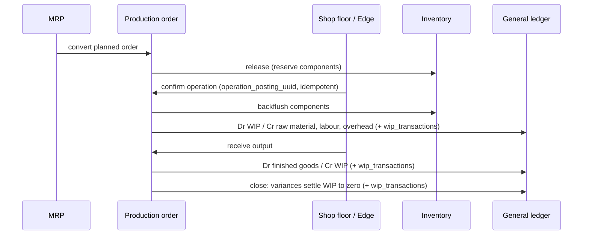
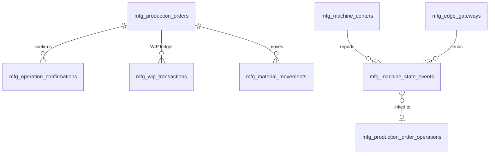

# Domain 07 — Manufacturing & MES (Issue #178)

Backend module: `modules/30_Manufacturing` (API under `/api/v1/manufacturing/...`). Quality, subcontracting, MRP, routings,
work centres and costing live in the same module; stock and lots come from `14_Inventory`, postings from `22_GeneralLedger`.

## Production strategies

| Strategy | Trigger | Pegging |
|----------|---------|---------|
| MTS | Forecast / safety stock -> MRP planned order -> production order | none |
| MTO | Sales order confirmation -> production order with `sales_order_id` | sales order |
| ATO | Configured sales order -> final-assembly order | `production_strategy = ATO` |

`production_strategy` is stored on `mfg_production_orders`; when null it is derived (`sales_order_id` set = MTO, else MTS).

## Order lifecycle and accounting

* **Idempotent posting** — `POST .../operations/{id}/confirmations` accepts `operation_posting_uuid`; a replay returns the
  original confirmation (HTTP 200) and posts nothing. Unique per tenant (`mfg_operation_confirmations.posting_uuid`).
* **WIP ledger** — every journal entry line on the WIP account writes one signed row in `mfg_wip_transactions`
  (material, conversion, subcontract, output, variance). The sum per order equals the WIP balance and is zero once closed.
* **Closure** — `closeOrder()` posts the variances and dispatches `ProductionVarianceReadyEvent` and `ProductionOrderClosedEvent`.

## Edge telemetry

`POST /api/v1/manufacturing/edge/telemetry` is public in the Sanctum sense and authenticated by `X-Gateway-Id` plus
`X-Signature` = hex HMAC-SHA256 of the raw body with the gateway secret (stored encrypted, returned once by
`POST /edge/gateways`). Batches up to 500 events; each event has `event_uuid` (idempotency key), `machine_id`, `state`
(`RUNNING|SETUP|IDLE|FAULT|MAINTENANCE`), `occurred_at`. An event updates the machine's live state only if newer, and is
linked to the operation running on the machine at that time.

## Read models

* `GET /cockpit` — open orders by strategy, machine states and FAULT/MAINTENANCE alerts, OEE and bottlenecks (>= 85 %
  utilization), MRP exceptions of the latest run, live WIP vs standard cost.
* `GET /production-orders/{id}/genealogy` — output lots backward to supplier lots and forward to deliveries, operators,
  machines and machine state events.

## Not yet covered

* Native clients (Angular command centre, WPF workbench, Flutter terminal) and the `Edge.Gateway` worker: separate repositories.
* ECO effectivity enforcement in MRP explosion and EUR.1 computation on order completion are covered by Mod 060 services
  but have no dedicated end-to-end test with this flow.
* Swiss 0.05 CHF rounding of variances and finite-capacity feedback of machine state into the MRP Gantt.
